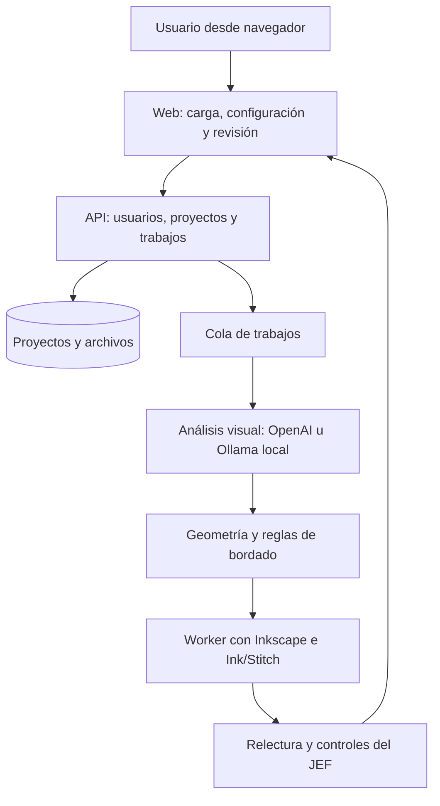

# Aplicación web de digitalización de bordados con IA

Fecha: 1 de noviembre de 2026. Estado: plan de desarrollo.

## 1. Producto propuesto

Una web privada, accesible desde distintos equipos, en la que el usuario pueda:

1. Subir una imagen de un logo o dibujo.
2. Indicar tamaño físico, tela, máquina, bastidor y cantidad aproximada de colores.
3. Elegir análisis con OpenAI o con un modelo de visión local disponible en el servidor.
4. Generar el diseño, con análisis y controles automáticos entre etapas.
5. Comparar el original, el vector y el recorrido real de las puntadas.
6. Corregir los elementos que la aplicación marque como ambiguos.
7. Descargar SVG editable, SVG de Ink/Stitch, JEF, vista previa e informe.
8. Guardar variantes de tamaño y registrar el resultado de la prueba en tela.

El primer alcance será logos planos, dibujos de pocos colores y line art. Las fotografías con perspectiva, degradados complejos y caligrafías difíciles se incorporarán al modo asistido conforme se mida la calidad de los algoritmos. El objetivo es automatizar los casos que superen los controles y mostrar una corrección localizada cuando haga falta.

Se propone comenzar con Janome MC 550E y salida JEF. Otros formatos y máquinas podrán añadirse mediante perfiles y adaptadores, después de verificar sus restricciones.

## 2. Qué hicimos realmente en Anime Socks

Los archivos existentes contienen una base útil, pero el primer trabajo combinó automatización con reconstrucción específica de ese logo.

| Etapa realizada | Evidencia local | Qué debe convertirse en una función general |
|---|---|---|
| Inspección de ejecutables, versiones y extensiones | Ayuda de Inkscape y descriptores `.inx` consultados | Detector de capacidades y configuración de rutas |
| Lectura visual del logo y separación de elementos | Identificación de letras, pétalos, hojas, ramas, capullos y corazones | Análisis semántico con IA y regiones verificables |
| Reconstrucción vectorial | `digitalizar.py` | Vectorización de entrada arbitraria y edición de zonas ambiguas |
| Preparación de satin, running y rellenos | SVG de Ink/Stitch y parámetros por objeto | Reglas dependientes del ancho real, material y escala |
| Reparación de áreas | `reparar_rellenos.py` | Reparador que conserve huecos e identidad de objetos |
| Orden de colores y recorridos | Orden y dependencias dentro de `digitalizar.py` | Optimizador con precedencias y restricciones de calidad |
| Exportación y plan completo | `exportar_validar.py` | Adaptador de motor ejecutable en servidor |
| Relectura y auditoría del JEF | `auditar.py` | Validador parametrizado por máquina y formato |
| Generación de otra escala | `crear_version_pequena.py` | Variantes que regeneren las puntadas a cada tamaño |
| Vista previa e informe | PNG desde coordenadas del JEF e informes | Salidas y estados basados en datos medidos |

En particular, `digitalizar.py` exige una imagen de 1122 × 1402 píxeles, usa recortes y umbrales concretos, contiene pétalos dibujados a mano y ejes caligráficos definidos para Anime Socks. **Cambiar solamente la ruta de la imagen no permite digitalizar otro logo.** Generalizar esa parte es el principal trabajo de investigación y desarrollo.

Los auditores también contienen condiciones específicas, como tres bloques de hilo y determinados bastidores. Habrá que sustituirlas por perfiles de destino. Los informes y rutas de ejecutables están vinculados a esta computadora.

## 3. Partes que se pueden reaprovechar

- El uso de SVG como documento editable y de las extensiones de Ink/Stitch para generar puntadas.
- Los patrones de invocación comprobados: captura binaria de stdout, registro de stderr, límites de tiempo y directorios temporales.
- Los controles de cabecera, registros, comandos, dimensiones y fin del JEF.
- La representación de la vista previa desde el archivo exportado y releído.
- El inventario de puntadas, saltos, cortes y cambios de hilo, indicando cómo se interpreta cada métrica.
- Las lecciones de la reducción: conservar proporciones, mantener separaciones físicas y ajustar trazos finos antes de volver a generar.

Como referencias congeladas, la versión grande mide 150 × 142,8 mm y su principal tiene 6.789 puntadas; la pequeña mide 126,2 × 120 mm y tiene 5.600 puntadas. Son resultados de esas versiones concretas, no objetivos universales de conteo ni prueba de calidad sobre tela. Los archivos no se verificaron en una máquina física durante este trabajo.

## 4. Arquitectura para usar desde varios equipos

El navegador muestra el proyecto y el progreso. Los cálculos largos y los programas nativos se ejecutan en procesos de trabajo separados del servidor web. Cada trabajo tiene su propio directorio y sus resultados quedan asociados a una versión.

Propuesta técnica inicial, sujeta a la prueba de viabilidad H0:

| Componente | Elección propuesta | Propósito |
|---|---|---|
| Interfaz | React y TypeScript | Subir imágenes, configurar tamaños y revisar resultados |
| API | Python, FastAPI y Pydantic | Contratos, proyectos, validación de solicitudes e integración con el motor |
| Persistencia | PostgreSQL | Usuarios, proyectos, versiones y estados durables |
| Trabajos largos | Redis y RQ | Cola, workers, límites de tiempo y reintentos controlados |
| Archivos | Almacenamiento privado; interfaz compatible con almacenamiento de objetos | Originales y artefactos separados de la base de datos |
| Motor | Inkscape e Ink/Stitch, con versiones fijadas | Convertir la geometría preparada en un plan y un archivo de máquina |
| Auditoría | pyembroidery y parser binario acotado del formato | Relectura, medidas y comprobaciones independientes del diseño SVG |
| IA de nube | Adaptador OpenAI | Interpretación visual y respuesta estructurada |
| IA local | Adaptador Ollama con modelo de visión compatible | Análisis dentro de la infraestructura propia |

La primera web puede estar en una red privada o alojada con acceso autenticado por Internet. Esta elección de despliegue se confirmará antes de publicar. No se necesita ejecutar un modelo en cada navegador.

El destino recomendado para el worker de servidor es un entorno Linux reproducible. **Su funcionamiento sin ventanas debe comprobarse antes de construir sobre él.** La automatización documentada por línea de comandos no demuestra por sí sola que todas las extensiones funcionen sin entorno gráfico. H0 probará instalación, dependencias gráficas o display virtual si fueran necesarios, exportación, fallos y tiempos de espera. Como alternativa de prototipo puede evaluarse un worker Windows; tampoco se dará por hecho que funcione como servicio sin sesión interactiva.

No corresponde alojar todo el procesamiento como una página estática o una función breve de servidor: Inkscape/InkStitch necesitan su entorno ejecutable. La interfaz sí puede desplegarse separada de los workers.

## 5. Papel de la IA dentro de la aplicación

### Análisis de la imagen

La IA identifica regiones, elementos, texto visible, colores y detalles posiblemente demasiado finos. Devuelve datos estructurados con referencias a la imagen. La precisión de un límite o una letra se comprueba contra píxeles o geometría; un JSON válido puede contener una interpretación equivocada.

### Geometría

El programa segmenta regiones, distingue siluetas y líneas, extrae contornos o ejes centrales y ajusta curvas. En dibujos lineales debe evitar trazar los dos bordes de una misma línea como dos recorridos independientes. La caligrafía mantiene su silueta en lugar de sustituirse automáticamente por otra fuente.

Las coordenadas aproximadas que sugiera un modelo sirven para localizar una región. El trazado preciso requiere algoritmos de imagen, un modelo de segmentación apropiado o corrección asistida. Ese módulo se evaluará con varios logos nuevos, sin incorporar sus coordenadas como código especial.

### Planificación de puntadas

La IA puede proponer la función de cada elemento y una técnica. Un motor de reglas decide, a escala física, si corresponde running, triple, satin o relleno; también comprueba anchura, direcciones, underlay, compensación y superposiciones. Los parámetros de Anime Socks serán un perfil inicial para gabardina, no valores obligatorios para todas las telas.

### Revisión opcional con una segunda IA

Puede comparar original, vector y representación del JEF para señalar texto perdido, detalles omitidos o cambios grandes de composición. Sus observaciones se convierten en incidencias vinculadas a objetos. La aceptación digital final depende de controles medidos y de revisión cuando exista ambigüedad.

La segunda IA de producción será configurable y se justificará por resultados en el conjunto de prueba. Tener varias IAs programando no obliga a pagar varias llamadas por cada imagen procesada.

## 6. OpenAI y modelos locales

Usar una interfaz común: `analyze(image, settings) → AnalysisSpec`. El proyecto conservará el proveedor, identificador del modelo, versión del prompt, respuesta recibida, duración y consumo informado por el proveedor.

Para OpenAI se propone entrada de imagen por Responses API y salida ajustada a un esquema con Structured Outputs, con un modelo que soporte esas capacidades. La documentación oficial distingue entrada visual y salidas estructuradas; el esquema no garantiza exactitud geométrica. Fuentes: [visión](https://developers.openai.com/api/docs/guides/images-vision) y [Structured Outputs](https://developers.openai.com/api/docs/guides/structured-outputs?api-mode=responses).

Para ejecución local, Ollama documenta entrada de imágenes con modelos de visión y salidas por esquema JSON. Se verificará la combinación concreta de modelo, versión y hardware antes de habilitarla. Usar Ollama local y usar su servicio de nube son modos distintos. Fuentes: [visión local](https://docs.ollama.com/capabilities/vision) y [salidas estructuradas](https://docs.ollama.com/capabilities/structured-outputs).

Los modelos locales correrán en el servidor o en un equipo de procesamiento conectado de forma privada al backend. Si el modelo local no está disponible, la aplicación informa el problema; la selección local no se transforma silenciosamente en una llamada de nube.

El modelo definitivo se elegirá con ejemplos representativos, midiendo calidad, coste por trabajo, latencia y uso de memoria. No se fija en este plan una marca de GPU, una tarifa ni un modelo «mejor» sin esas pruebas. Las claves de los proveedores se administran en el backend.

## 7. Experiencia de uso de la primera versión

El recorrido principal será: **crear proyecto → subir imagen → indicar destino → generar → revisar o descargar**.

La revisión mostrará el original, el vector y la representación del JEF releído. Permitirá activar regiones, corregir la paleta, cambiar la técnica de un elemento y generar una variante de tamaño. La primera versión puede abrir/exportar SVG para correcciones avanzadas en Inkscape y reimportarlo; un editor Bézier completo en el navegador queda para una ampliación.

Si un logo admite procesamiento automático y supera los controles, pasa a «listo para prueba». Si falta información o hay una geometría dudosa, muestra la zona concreta y la corrección necesaria. No se pide confirmar cada operación rutinaria.

Los usuarios acceden a los proyectos para los que tienen permiso. Las subidas tienen límites configurables y los SVG utilizados en la web se procesan como contenido gráfico sanitizado. Los datos de los modelos se validan como datos; el servidor ejecuta operaciones previstas del motor con argumentos controlados.

## 8. Fases y puertas de aceptación

| Hito | Entrega | Responsable principal | Se acepta cuando |
|---|---|---|---|
| H0. Viabilidad y contratos | Adaptador del motor y contratos v0.1 | IA 1 | El entorno de servidor genera JEF de los SVG conocidos sin intervención de escritorio; devuelve fallos y límites de tiempo de forma controlada |
| H1. Recorrido web real | Crear proyecto, subir SVG preparado, ejecutar y descargar | IA 1 + IA 2 | Dos equipos pueden usar la web y obtener artefactos reales asociados a trabajos separados |
| H2. Imagen a geometría | Análisis visual, regiones y vectorización general | IA 3, o IA 1 si son dos | Procesa varios logos nuevos sin introducir sus nombres, tamaños de imagen o coordenadas como reglas especiales |
| H3. Digitalización y revisión | Running, triple, rellenos y satin verificados; corrección por objeto | IA 1 + IA 2 | La imagen y la configuración producen un JEF medido, o una incidencia concreta que permite continuar tras corregir |
| H4. Proveedores y robustez | OpenAI y modelo local intercambiables; trabajos recuperables | IA 3 + integración | Ambos producen el contrato común y hay manejo de errores, cancelación, consumo y archivos versionados |
| H5. Piloto en tela y publicación privada | Muestras, perfiles ajustados y despliegue reproducible | Integración + usuario | Se documentan resultados físicos, acceso desde varios equipos y procedimientos de operación |

H1 ofrece valor aunque H2 siga en investigación: permite generar y gestionar bordados desde vectores preparados. La inversión siguiente se concentra en la automatización de imágenes, que es el tramo menos resuelto del proceso anterior.

## 9. Evaluación de calidad

Preparar un conjunto inicial de unas 15–20 imágenes con permiso de uso: logos planos, line art, letras, curvas cerradas con huecos, transparencias y ejemplos que deban pedir revisión. Incluir las dos escalas de Anime Socks y al menos cinco diseños nuevos de aspecto distinto. Las variantes de un mismo logo no cuentan como cinco diseños nuevos.

Evaluar por separado:

- Fidelidad visual: letras reconocibles, proporciones, huecos y elementos conservados.
- Geometría: cruces, áreas degeneradas, duplicados, ejes y columnas aptas para satin.
- Bordado: dirección, densidad local, underlay, precedencias, saltos y cortes.
- Formato: archivo íntegro, dimensiones reales, paleta aproximada y bastidor declarado.
- Operación web: trabajos concurrentes, interrupciones, persistencia y acceso a artefactos.
- Prueba física: legibilidad, arrugas, rigidez, cobertura y respuesta de la tela.

Las tolerancias y perfiles se calibrarán con esas muestras. No se fija un porcentaje de éxito de la IA sin medirlo. Tampoco se evalúa calidad solamente por reducir el número de puntadas.

Un archivo puede estar íntegro digitalmente y requerir cambios en tela. La aplicación registrará por separado «listo para prueba» y «muestra física aprobada».

## 10. Primer entregable que conviene construir

Una web que acepte un SVG preparado de Anime Socks, reciba un tamaño objetivo, ejecute el motor en un worker y permita descargar un JEF cuya medida y vista previa se obtengan por relectura. Esto comprueba la conexión entre navegador, backend y programas de bordado antes de añadir la incertidumbre de una imagen nueva.

Al mismo tiempo, la segunda IA puede desarrollar la interfaz contra los contratos acordados. La tercera, si se incorpora, trabaja sobre análisis y vectorización sin modificar la interfaz del motor.

No se fijan semanas ni presupuesto de infraestructura hasta completar H0 y un primer conjunto de pruebas de H2. El resultado de esos hitos permitirá estimar con evidencia la parte de geometría y el hardware para IA local.

## Fuentes de automatización verificadas para este plan

- [Ink/Stitch: ejecución por línea de comandos](https://inkstitch.org/docs/command-line/): extensiones y generación del plan de puntadas.
- [Ink/Stitch: flujo de trabajo](https://inkstitch.org/docs/workflow/): preparación, orden, revisión y exportación conservando el SVG editable.
- [pyembroidery](https://github.com/EmbroidePy/pyembroidery): lectura y escritura de formatos de bordado; se utilizará junto con controles binarios propios.
- [RQ: workers](https://python-rq.org/docs/workers/): procesos para trabajos prolongados separados de los procesos web.

Las elecciones de arquitectura, hitos y condiciones de aceptación son propuestas de este proyecto, no garantías de los proveedores citados.
